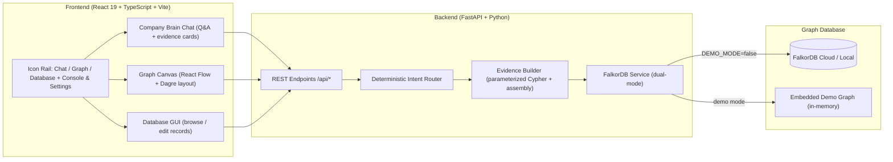

# 🧠 OrgMind — An Evidence-First Company Brain

> **WeMakeDevs × FalkorDB Graph Hacks** — Target Track: **Company Brain**
> Ask a company question in plain English, get an answer traced through a real **FalkorDB** knowledge graph — with the exact Cypher, the evidence records, and the causal path shown on an interactive canvas. No guessing, no hallucinated facts: every claim is grounded in a node or relationship that exists in the graph.

---

## 🎯 The Problem & Solution

Traditional AI assistants answer "Why is this project delayed?" with plausible-sounding prose that can't be verified. OrgMind instead:

1. Parses the question into a **deterministic intent** (no LLM, no API key, no cost).
2. Generates **parameterized Cypher** and runs it against FalkorDB (or the embedded demo graph).
3. Renders an **executive answer** built only from verified graph properties: delay days, owners, blockers, pending decisions.
4. Highlights the **causal path** on an interactive React Flow + Dagre graph, and links each evidence card to the exact records.

---

## ✨ Features (what's actually in the app)

| Area | What works today |
|---|---|
| **💬 Company Brain Chat** | Project selector (Titan / Apollo / Mercury / All), suggested questions, structured answer cards (story summary, delay metrics, causal chain blocks, active blocker records), collapsible raw Cypher panel with copy button, loading + error states |
| **🕸️ Knowledge Graph** | Dagre auto-layout (horizontal/vertical toggle), directory index with search + label filters, click-to-select with 1-hop neighborhood focus, evidence-path highlighting from chat answers, dimming of unrelated nodes, mini-map, fit-view, flashcard open ("Flip") |
| **🗄️ Company Knowledge Database** | Browse all records by category (Projects, Teams, People, Tasks, Decisions, Documents), search/filter, add / edit / delete with validation and success feedback, open detailed flashcards. **Session-only** — see limitations below |
| **⚙️ Settings** | FalkorDB connection form (host, port, credentials, SSL, graph name), live connection test, connect, switch back to Zero-Config Demo Mode |
| **🖥️ Cypher Console** | Preset queries + free-form Cypher against the connected graph, tabular results, error display |
| **🌱 Seeding** | One-click idempotent `MERGE` re-seed of the NovaTech Logistics demo dataset |

---

## 🏛️ Architecture



**Zero-Config Demo Mode:** out of the box OrgMind runs against an embedded NovaTech Logistics graph (17 nodes / 22 edges: projects, tasks, people, decisions, documents, teams), so the full demo works without any database. Set `DEMO_MODE=false` and fill in credentials to switch to a live FalkorDB instance — no code changes.

---

## 🛠️ Tech Stack

- **Frontend:** React 19, TypeScript, Vite, @xyflow/react (React Flow), @dagrejs/dagre, lucide-react
- **Backend:** FastAPI, Pydantic, uvicorn, `falkordb` Python client
- **Database:** FalkorDB (Redis-compatible graph database, Cypher queries)
- **Tests:** pytest + FastAPI TestClient (15 tests)

---

## ⚡ Quick Start

**Prerequisites:** Python 3.10+, Node.js 18+ & npm

### Option A — one command

```bash
./start.sh
```

Creates `backend/.venv`, installs frontend deps, copies `.env.example` → `.env` (demo mode), then runs:

- Frontend: http://127.0.0.1:5173
- Backend: http://127.0.0.1:8000 (Swagger: http://127.0.0.1:8000/docs)

Stop with `./stop.sh`.

### Option B — Freebuff preview (managed)

```bash
freebuff-preview start
```

Runs `sh ./scripts/preview.sh`, which starts both FastAPI (port 8000) and Vite (managed preview port, `0.0.0.0`). The frontend proxies `/api` → backend, so the preview URL serves the full app.

### Manual

```bash
# backend
python3 -m venv backend/.venv
backend/.venv/bin/pip install -r backend/requirements.txt
backend/.venv/bin/uvicorn app.main:app --app-dir backend --port 8000

# frontend (separate terminal)
npm --prefix frontend install
npm --prefix frontend run dev
```

---

## 🌐 Connecting FalkorDB Cloud

1. Open the app → click the **Settings** gear (bottom of the left rail).
2. Enter your credentials from [app.falkordb.cloud](https://app.falkordb.cloud):
   - **Host**, **Port** (usually `6379`), **Username** (`default`), **Password**, **SSL** toggle, **Graph Name**
3. Click **Test Connection**, then **Save & Connect**.
4. Click the **Re-Seed** (↻) button in the rail to load the demo dataset into your graph via idempotent `MERGE` statements (safe to run repeatedly).

Or configure via `.env` in the project root (never committed):

```ini
FALKORDB_HOST=your-cluster.falkordb.cloud
FALKORDB_PORT=6379
FALKORDB_USERNAME=default
FALKORDB_PASSWORD=your_password
FALKORDB_GRAPH=orgmind_demo
FALKORDB_SSL=true
DEMO_MODE=false
```

---

## 🎬 Demo Flow (for judges)

1. **Ask** — the app opens on *“Why is Project Titan delayed?”*. The answer card shows the verified story, delay metrics (18 days, critical blockers, pending decisions), and the causal chain: **Project Titan → API Gateway v2 → SOC2 telemetry sign-off → DEC-2024-08 → Elena Rostova**.
2. **Trace** — click any block in the causal chain (or an evidence card) to open its flashcard: full properties, incoming/outgoing relationships.
3. **Explore** — switch to the **Graph** tab (workflow icon): the same path is highlighted on the Dagre-layout canvas while unrelated nodes dim. Click any node to focus its 1-hop neighborhood; toggle horizontal/vertical layout; use the directory index to filter by label.
4. **Inspect records** — switch to the **Database** tab: browse every entity by category, search, and open record flashcards. Edits here are session-only (clearly labeled in the UI).
5. **Go deeper** — open the **Cypher Console** (terminal icon) to run the exact queries yourself, or **Settings** to point OrgMind at a live FalkorDB Cloud cluster.

More track questions that work out of the box: *“Which tasks are blocking this launch?”*, *“Who owns the blocking task?”*, *“Which decisions are still pending?”*, *“What depends on this task?”*, *“Show the evidence connected to this issue.”*

---

## 📊 Graph Data Model

NovaTech Logistics demo dataset: **6 node labels, 10 relationship types**.

### Node Labels
| Label | Description | Example Properties |
|---|---|---|
| **Project** | Initiatives & milestones | `id: 'proj-titan'`, `name`, `status: 'DELAYED'`, `delay_days: 18`, `target_date`, `progress` |
| **Task** | Engineering/security/rollout tickets | `id: 'task-deploy-gateway'`, `title`, `status: 'BLOCKED'`, `priority`, `blocker_reason` |
| **Person** | Engineers, leads, executives | `id: 'person-elena'`, `name`, `role`, `email`, `team` |
| **Decision** | Governance & architecture records | `id: 'dec-telemetry-residency'`, `title: 'DEC-2024-08'`, `status`, `impact`, `rationale` |
| **Document** | Specs, audits, RFCs, SLAs | `id: 'doc-sec-audit'`, `title`, `type`, `url`, `summary` |
| **Team** | Departments | `id: 'team-platform'`, `name`, `department` |

### Relationships
`HAS_TASK` (Project→Task) · `BLOCKED_BY` (Task→Task) · `DEPENDS_ON` (Task→Decision) · `ASSIGNED_TO` (Task→Person) · `WAITING_FOR` (Task→Person) · `OWNS` (Person→Project) · `MADE_BY` (Decision→Person) · `REFERENCES` (Decision→Document) · `MENTIONS` (Task→Document) · `MEMBER_OF` (Person→Team)

### Core hackathon query (root-cause delay tracing)

```cypher
MATCH (p:Project {id: $projectId})-[:HAS_TASK]->(t:Task)
WHERE t.status = 'BLOCKED' OR t.delay_days > 0
OPTIONAL MATCH (t)-[:BLOCKED_BY]->(blocker:Task)
OPTIONAL MATCH (blocker)-[:ASSIGNED_TO]->(owner:Person)
OPTIONAL MATCH (blocker)-[:WAITING_FOR]->(waiting:Person)
OPTIONAL MATCH (blocker)-[:DEPENDS_ON]->(dec:Decision)
OPTIONAL MATCH (dec)-[:MADE_BY]->(decider:Person)
OPTIONAL MATCH (dec)-[:REFERENCES]->(doc:Document)
OPTIONAL MATCH (t)-[:MENTIONS]->(taskDoc:Document)
RETURN p, t, blocker, owner, waiting, dec, decider, doc, taskDoc
```

---

## 🧪 Tests

```bash
# backend (15 tests: intent routing, Cypher generation, evidence extraction, REST endpoints)
PYTHONPATH=backend backend/.venv/bin/pytest backend/tests -v

# frontend
npm --prefix frontend run build   # tsc -b + vite build
npm --prefix frontend run lint    # oxlint
```

Covered: why-Titan-is-delayed, blocking tasks, task ownership, pending decisions, downstream dependencies, evidence explorer, project filtering, schema statistics, health/config/graph/schema/query/seed endpoints.

---

## 🛡️ Design Principles

- **No hallucination:** answers are assembled only from properties and relationships present in the graph; missing facts are declared as missing.
- **No AI provider dependency:** deterministic intent routing + templated Cypher — zero API keys, zero cost, works offline in demo mode.
- **No secrets in the frontend:** the browser only talks to FastAPI; credentials live in `.env` (gitignored) or are entered in the Settings modal.
- **Lightweight:** no Docker, no ML weights, instant startup.

---

## ⚠️ Known Limitations

- **Database tab writes are session-only.** The backend deliberately exposes no node CRUD API, so add/edit/delete in the Database tab change browser state only and reset on reload, project switch, or re-seed. The UI labels this explicitly. Read paths (graph, chat, console) are fully backed by the database.
- **Demo mode is the default.** Without FalkorDB credentials the app serves the embedded dataset (fully functional, deterministic).
- **Answer intents are curated,** not open-ended NLU: the six demo questions above (and close paraphrases) route to purpose-built Cypher; other phrasings fall back to the general project-status answer.
