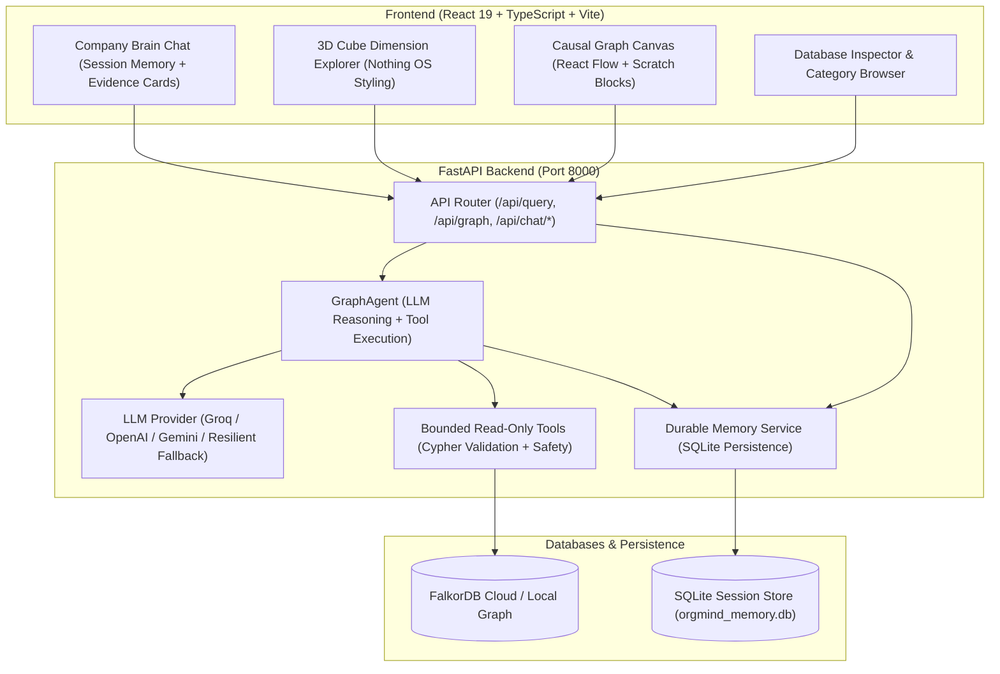
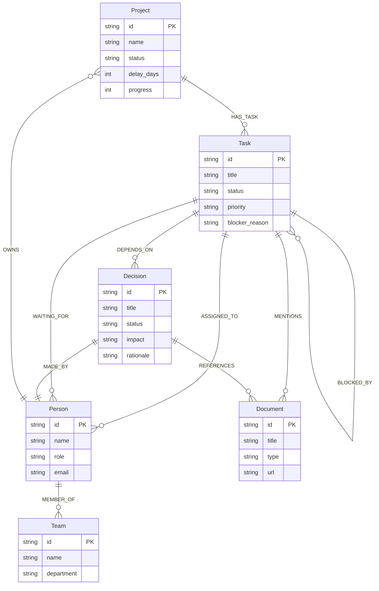

# 🧠 OrgMind — Evidence-First Company Brain

> **WeMakeDevs × FalkorDB Graph Hacks** — Target Track: **Company Brain**
> Ask complex organizational questions in plain English, get answers traced through a real **FalkorDB** knowledge graph — backed by exact Cypher queries, verified evidence records, and interactive 3D spatial and workflow graph visualizers.

---

## 🎯 The Problem & Solution

Traditional AI assistants answer *"Why is this project delayed?"* with plausible-sounding prose that cannot be audited or verified. They hallucinate non-existent team members, invent tasks, and fail to provide the causal links between blockers, decisions, and people.

**OrgMind solves this through an Evidence-First Architecture:**
1. **Real Graph Grounding**: Company data lives as a connected knowledge graph in **FalkorDB**, connecting Projects, Teams, People, Tasks, Decisions, and Documents.
2. **Tool-Using Agent**: Plans and executes bounded read-only Cypher queries against FalkorDB. Mutations (`CREATE`, `SET`, `DELETE`, `MERGE`, `DROP`) are strictly blocked.
3. **Verified Evidence Cards**: Every claim cites specific entity IDs (`proj-titan`, `task-deploy-gateway`, `dec-telemetry-residency`), relationships, and exact properties.
4. **Durable Conversation Memory**: Multi-turn dialogue and user context persist in an isolated SQLite store across page refreshes and backend restarts, keeping remembered context clearly separated from verified graph facts.
5. **Spatial & Workflow Visualizers**: Interactive Nothing OS-inspired 3D CSS cube dimension explorer, React Flow causal dependency canvas, and directory index.

---

## 🏛️ System Architecture



---

## 📊 FalkorDB Graph Ontology

OrgMind models organizational reality across **6 core node labels** and **10 relationship types**:



---

## 🤖 How the Agent Queries FalkorDB

When a user asks: *"Why is Project Titan delayed and who owns the blocker?"*

1. **Memory Retrieval**: The agent loads prior session context from SQLite.
2. **Schema & Tool Planning**: The agent calls `get_graph_schema` and plans a read-only Cypher query:
   ```cypher
   MATCH (p:Project {id: 'proj-titan'})-[:HAS_TASK]->(t:Task)
   WHERE t.status = 'BLOCKED' OR t.delay_days > 0
   OPTIONAL MATCH (t)-[:BLOCKED_BY]->(b:Task)
   OPTIONAL MATCH (t)-[:ASSIGNED_TO]->(owner:Person)
   OPTIONAL MATCH (t)-[:DEPENDS_ON]->(dec:Decision)-[:MADE_BY]->(decider:Person)
   RETURN p, t, b, owner, dec, decider
   ```
3. **Safety Validation**: `AgentGraphTools.validate_readonly_cypher()` ensures no mutation keywords (`CREATE`, `SET`, `DELETE`, `MERGE`, `DROP`) exist.
4. **Execution & Evidence Assembly**: FalkorDB executes the Cypher statement. Retrieved records are structured into verified `EvidenceItem` objects.
5. **Answer Synthesis**: The answer is formatted with distinct sections:
   - **### Direct Answer**: High-level executive synthesis.
   - **### Verified Graph Evidence**: Citations of specific node IDs and relationship paths.
   - **### Inferences & Causal Analysis**: Analysis connecting dependencies to delays.
   - **### Missing Information & Uncertainties**: Explicit disclosure of missing data.
6. **Durable Memory Update**: The user prompt and assistant response are persisted to SQLite for subsequent follow-up questions.

---

## 💾 Durable Conversation Memory

Unlike transient chatbots that lose context upon refresh, OrgMind implements session-isolated SQLite persistence:
- **Location**: `backend/data/orgmind_memory.db` (gitignored, automatic schema migration).
- **Session Scoping**: Scoped via `session_id`, persisted in browser `localStorage`. Survives page reloads and backend restarts.
- **Fact Extraction**: User preferences or statements ("Remember that Marcus Vance is on call") are captured in `extracted_facts`.
- **Fact vs. Memory Distinction**: The agent explicitly treats remembered context as conversation memory, **never** as verified company facts in FalkorDB unless confirmed by graph records.

---

## ⚡ Quick Start

### Prerequisites
- Python 3.10+
- Node.js 18+ & npm

### 1. Launch Application

```bash
./start.sh
```

This starts:
- **FastAPI Backend**: `http://127.0.0.1:8000` (API Docs: `http://127.0.0.1:8000/docs`)
- **React Vite Frontend**: `http://127.0.0.1:5173`

Stop anytime with `./stop.sh`.

---

## 🌐 Connecting FalkorDB Cloud

OrgMind runs in Zero-Config Demo Mode by default (embedded NovaTech Logistics graph). To connect your real FalkorDB Cloud instance:

1. Click the **Database Settings** icon (gear) in the left sidebar rail.
2. Enter your credentials from [app.falkordb.cloud](https://app.falkordb.cloud):
   - **Host**: e.g., `your-endpoint.falkordb.com`
   - **Port**: `6379`
   - **Username**: `default`
   - **Password**: `your_password`
   - **SSL**: Toggle on for Cloud
   - **Graph Name**: `orgmind_demo` (or your preferred graph)
3. Click **Test Connection**, then **Connect & Persist**.

### Safe Opt-In Seeding (No Automatic Overwrites)
To protect production data, database seeding requires explicit authorization:
```bash
# Dry run: inspect what would be seeded without writing
python backend/seed_db.py --dry-run

# Explicit opt-in seed with collision protection
python backend/seed_db.py --confirm
```
Every seeded record is tagged with `_demo: true` and `dataset: 'novatech-logistics'`.

---

## 🧪 Automated Test Suite

Run the full backend and frontend verification suite:

```bash
# Run all 33 backend unit & integration tests
PYTHONPATH=backend backend/.venv/bin/pytest backend/tests/ -v

# Run frontend type-check & production build
npm --prefix frontend run build
```

### Test Coverage Summary (33 Tests Passed)
- `test_agent.py` (8 tests): Read-only Cypher enforcement, mutation blocking (`CREATE`, `SET`, `DELETE`, `MERGE`), tool execution, empty graph honest reporting, memory vs. fact distinction.
- `test_memory.py` (5 tests): SQLite session isolation, message persistence across restarts, context formatting, session clearance.
- `test_brain_service.py` (11 tests): Curated intent routing, delay root-cause analysis, blocker ownership, transparency on unrecognised queries.
- `test_routes.py` (9 tests): REST endpoints (`/api/health`, `/api/config`, `/api/graph`, `/api/schema`, `/api/query`, `/api/seed`, `/api/chat/*`).

---

## 🎬 Reproducible End-to-End Demo

Follow this flow for evaluating OrgMind:

1. **Verify Connection & Graph State**:
   - Open `http://127.0.0.1:5173`.
   - The top banner shows `Live FalkorDB` or `Demo graph`, schema node counts, and connection health.
2. **Ask a Graph Grounded Question**:
   - In Company Brain Chat, ask: *"Why is Project Titan delayed?"*
   - Observe the executive answer, verified evidence items, delay metrics, and exact Cypher query in the technical drawer.
3. **Inspect the 3D Cube & Causal Workspace**:
   - Switch to the **Workflow** canvas to view the causal chain:
     `Project Titan ➔ Deploy API Gateway v2 ➔ SOC2 Telemetry Sign-Off ➔ DEC-2024-08 ➔ Elena Rostova`
   - Notice the highlighted nodes and edges matching the query evidence.
4. **Test Durable Conversation Memory & Follow-Up**:
   - Type: *"Remember that Marcus Vance is the primary engineer on call this week."*
   - Brain confirms the note is recorded in session memory.
   - Refresh the browser (`F5`).
   - Ask: *"Who did I say is on call this week?"*
   - Brain correctly retrieves the fact from SQLite memory, answering that Marcus Vance was stated as on-call, while explicitly clarifying that this is conversation memory rather than an independently verified database record.
5. **Test Mutation Safety**:
   - Open Cypher Console in Settings and run: `CREATE (n:FakeNode)`
   - The tool-safety layer rejects the mutation with an explicit read-only permission error.
